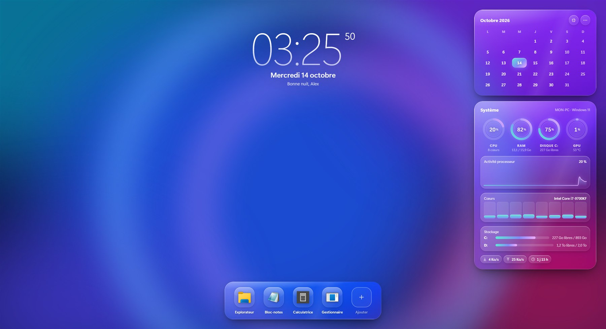

# Glass Widget

Un widget de bureau pour Windows, au style verre dépoli : horloge, calendrier, données du PC (processeur, mémoire, disques, carte graphique, réseau) et raccourcis vers tes applications. Il s'utilise en carte compacte ou en plein écran. *Available in English too.*

**🌐 Site : [arctis34.github.io/glass-widget](https://arctis34.github.io/glass-widget/)**

## Télécharger

**[⬇ Télécharger la dernière version](https://github.com/arctis34/glass-widget/releases/latest)**, puis clique sur le fichier `Glass-Widget-Setup-x.y.z.exe`.

## Installer

1. Lance le fichier téléchargé. Un écran d'attente s'affiche quelques secondes.
2. Si Windows affiche **« Windows a protégé votre ordinateur »**, clique sur **Informations complémentaires**, puis sur **Exécuter quand même**. Ce message apparaît parce que l'installeur n'est pas encore signé par un certificat payant.
3. Choisis tes options et clique sur **Installer**. Aucun droit administrateur n'est nécessaire.

Les mises à jour arrivent ensuite toutes seules : le widget propose d'installer chaque nouvelle version, après avoir vérifié sa signature numérique. Tes réglages sont conservés.

## Configuration

Windows 11, 64 bits.

## Désinstaller

**Paramètres → Applications → Applications installées → Glass Widget → Désinstaller.**

## Confidentialité

- Aucune donnée personnelle n'est envoyée : le widget lit les informations du PC et ton fond d'écran localement.
- Pour vérifier les mises à jour, il interroge GitHub quelques fois par jour. GitHub voit alors ton adresse IP, comme pour n'importe quelle page web.
- Le journal d'erreurs reste sur ton PC (`%APPDATA%\Glass Widget\logs`). Tu choisis de le joindre ou non quand tu signales un problème.
- Pas de publicité, pas de mesure d'audience, pas de compte à créer.

## Un problème ?

Menu ⋯ du widget → **Signaler un problème**, ou [ouvre un ticket ici](https://github.com/arctis34/glass-widget/issues/new).
